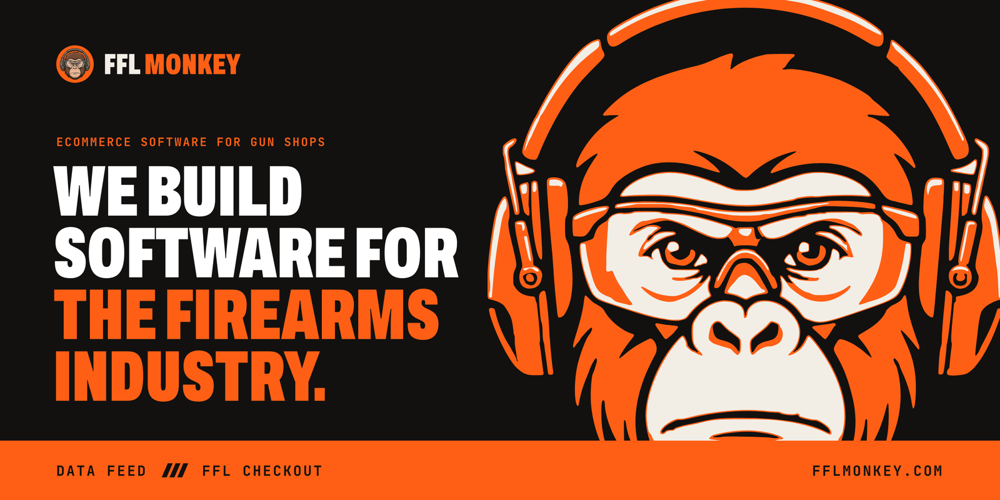
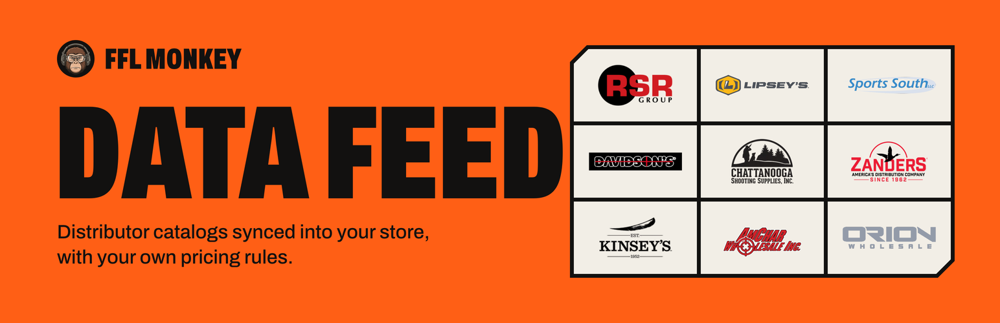
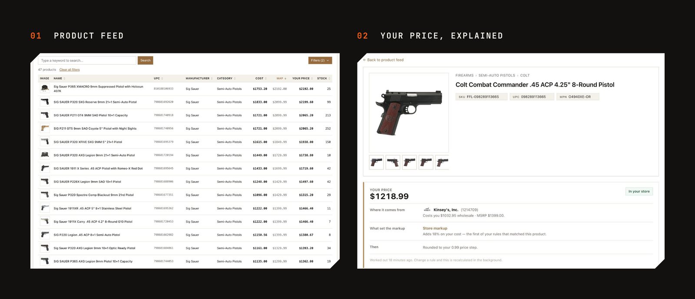
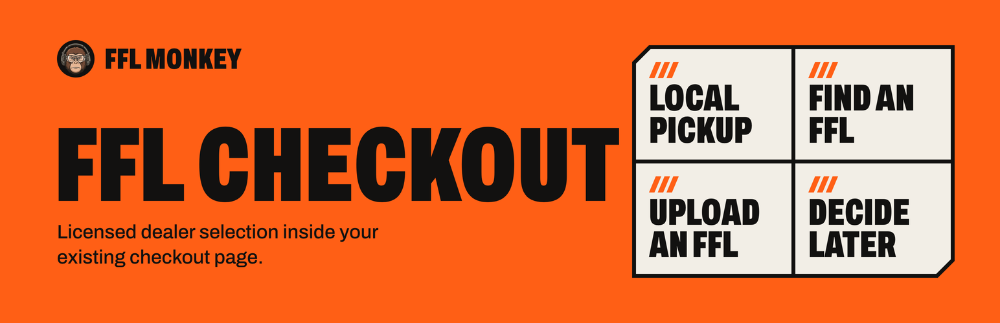
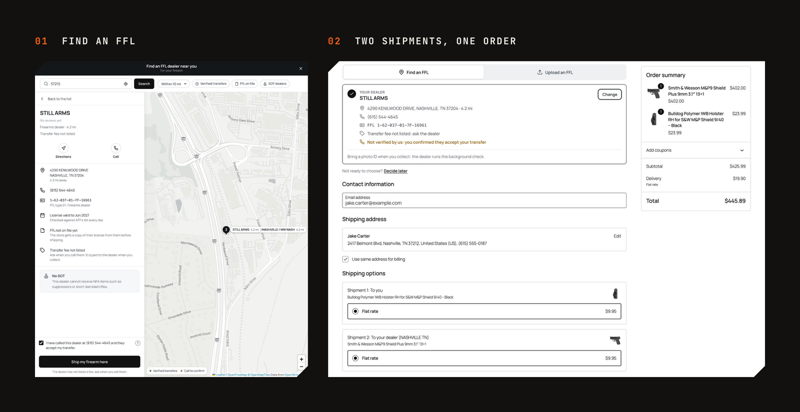

<h1 align="center">FFL Monkey: eCommerce software for gun shops</h1>

  Two plugins for firearms retailers selling online, on WooCommerce, BigCommerce and Magento. 
  We import products from your distributors' catalogs into your website and update prices and stock every hour. 
  At checkout, your buyers pick the FFL dealer their gun ships to.

  
  &nbsp;
  

 

## Data Feed: a firearms distributor feed for gun shops

Data Feed imports your distributors' catalogs into your online store with photos and specs, priced by your markup, and updates prices and stock every hour. Sell what your distributors carry without entering it by hand.

- **Guns, ammo and gear** from RSR Group, Sports South, Davidson's and more
- **Your markup** on their cost, never below MAP
- **Prices and stock** updated every hour

**Distributors Data Feed connects to:** [RSR Group](https://fflmonkey.com/distributors/rsr-group), [Sports South](https://fflmonkey.com/distributors/sports-south), [Lipsey's](https://fflmonkey.com/distributors/lipseys), [Davidson's](https://fflmonkey.com/distributors/davidsons), [Chattanooga Shooting Supplies](https://fflmonkey.com/distributors/chattanooga), [Zanders](https://fflmonkey.com/distributors/zanders), [Kinsey's](https://fflmonkey.com/distributors/kinseys), [Amchar](https://fflmonkey.com/distributors/amchar) and [Orion Wholesale](https://fflmonkey.com/distributors/orion). You keep your own distributor accounts.

  
  &nbsp;
  <a href="https://fflmonkey.com/products/data-feed">Everything Data Feed does &rarr;</a>

 

## FFL Checkout: FFL dealer search at checkout

FFL Checkout adds the dealer step to your online store's checkout. Your buyers pick a licensed FFL dealer from the ATF's list, and the gun ships there. Sell guns online with the FFL dealer step in your checkout.

- **Licensed dealer search** by ZIP code, with a map
- **The gun ships to the dealer**, the rest ships home
- **The dealer's license** saved with the order

  
  &nbsp;
  
  &nbsp;
  <a href="https://fflmonkey.com/products/ffl-checkout">Everything FFL Checkout does &rarr;</a>

 

## WooCommerce, BigCommerce and Magento

- **WooCommerce:** both plugins, classic and block checkout, HPOS and legacy order storage.
- **BigCommerce:** both plugins. Nothing to install: FFL Monkey connects to your store through BigCommerce's API.
- **Magento:** both plugins, on Magento Open Source and Adobe Commerce.

## For developers

Keep your store's in-house inventory current with the Inventory API, and read your products at your prices with the Store API.

## Questions gun shops ask

**Do I need my own distributor accounts?** 
Yes, and you keep them. Your terms and your relationships stay yours. We never buy on your behalf and we never sit between you and your distributor.

**How fast does a price change reach my store?** 
Within the hour. Data Feed checks each distributor every hour, and when a cost, a stock level or a product changes, our server pushes the change to your site.

**What if my site is down when something changes?** 
Nothing is lost. Every change carries a cursor, and an hourly check notices the gap and asks for exactly what was missed. Your backlog is held for you rather than dropped.

**What happens to a cart holding a rifle and a holster?** 
It splits itself. The firearm is quoted and shipped to the dealer the buyer picked, everything else to their door, and both halves stay one order with one payment.

**Where does the dealer list come from?** 
The [ATF FFL eZ Check](https://fflezcheck.atf.gov/) dataset, imported and kept current, plus licenses uploaded by dealers themselves which are read, matched against the federal record and only then trusted. You never maintain a dealer list.

**Is there a setup fee or a cut of my sales?** 
Neither. Flat monthly or yearly, cancel from your own billing screen. We take no percentage of anything you sell and there is no per-transaction charge.

 

  <a href="https://fflmonkey.com">fflmonkey.com</a>
  &nbsp;&middot;&nbsp;
  <a href="mailto:info@fflmonkey.com">info@fflmonkey.com</a>
  &nbsp;&middot;&nbsp;
  <a href="https://www.instagram.com/fflmonkey">Instagram</a>
  &nbsp;&middot;&nbsp;
  <a href="https://www.linkedin.com/company/fflmonkey">LinkedIn</a>
  &nbsp;&middot;&nbsp;
  <a href="https://x.com/fflmonkey">X</a>
  &nbsp;&middot;&nbsp;
  <a href="https://www.youtube.com/@fflmonkey">YouTube</a>

